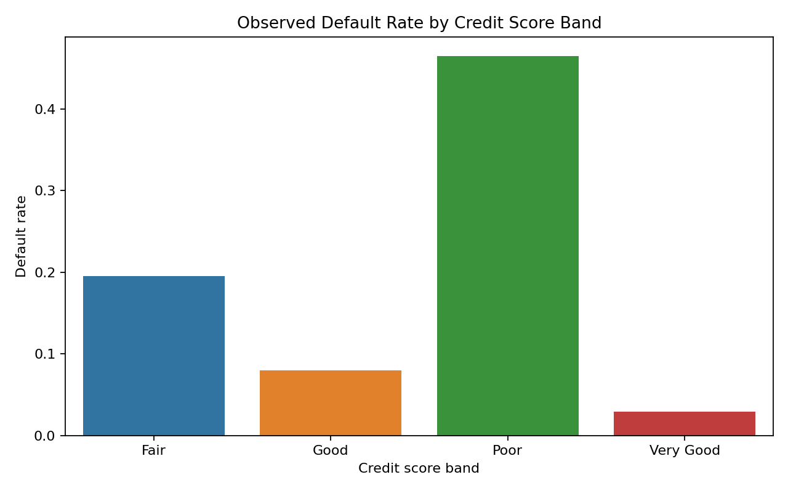
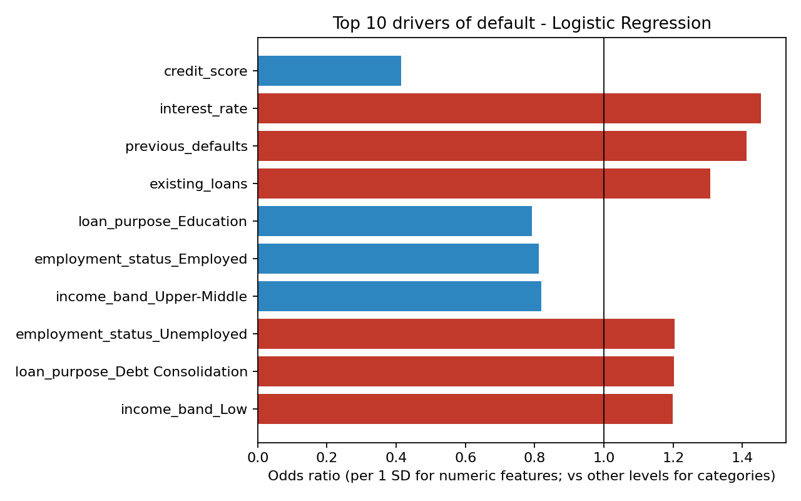
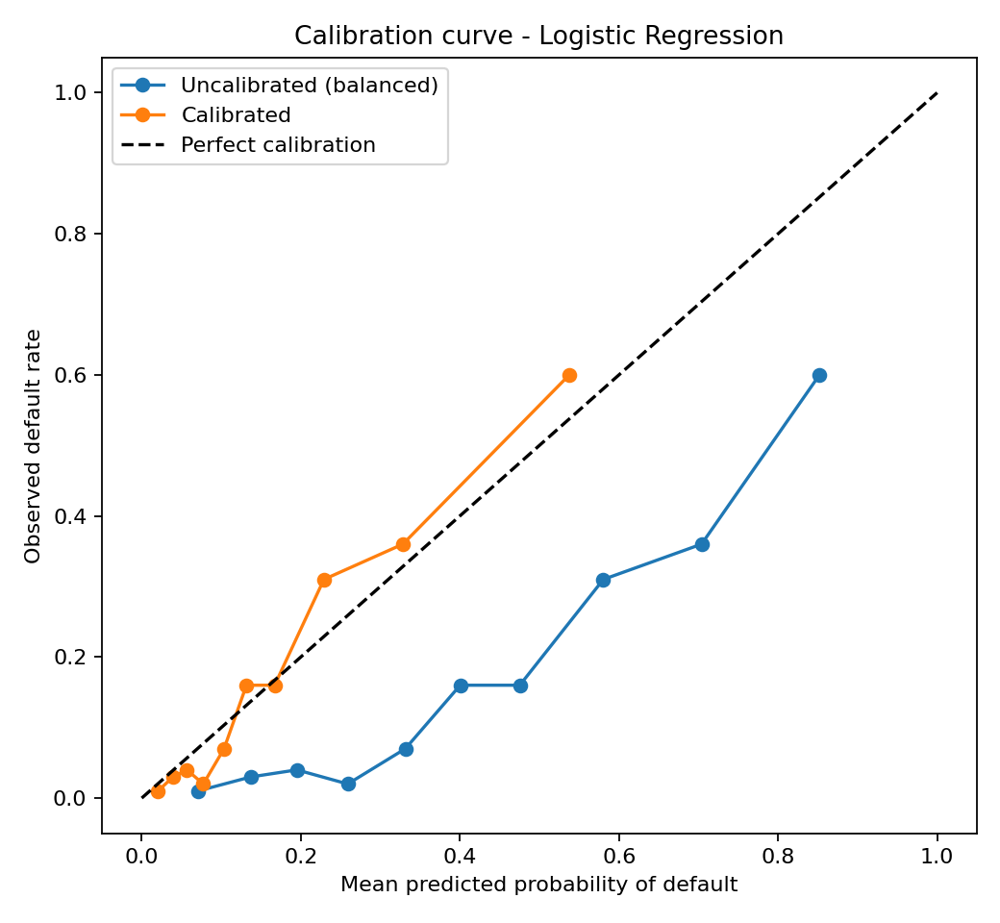
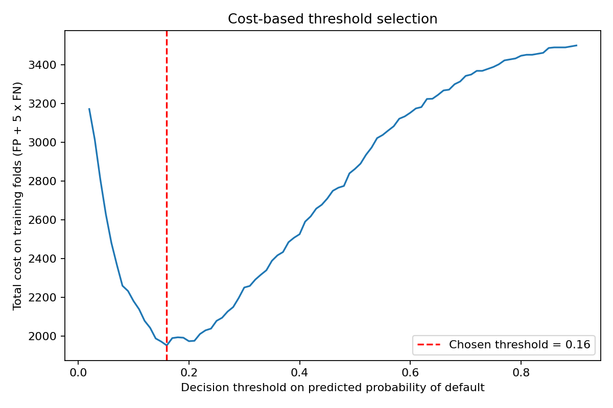
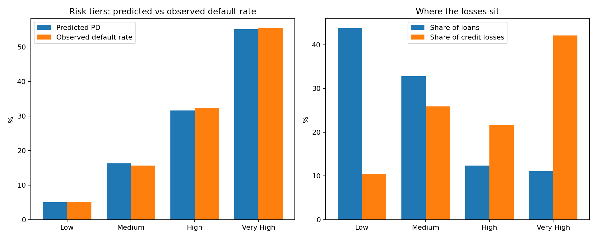

# Credit Risk Analytics: Predicting Loan Default

**Python | pandas | scikit-learn | SQL | Power BI (specification)**

> **Data note:** this project uses a **synthetic** dataset of 5,000 loan applications. No real customer data is used, and results do not describe any real bank or lending book.

## Executive summary

**The problem.** About 1 in 6 loans in this portfolio defaults (17.6%). On R1.18 billion lent, credit losses are about **R107 million** (9.0% of the book), assuming the bank loses 45% of the loan amount when a borrower defaults.

**What the analysis found.** A transparent logistic regression ranks borrowers well (ROC-AUC 0.79 in cross-validation) and, once calibrated, its probabilities are reliable: in every risk tier the predicted default rate is within 1 percentage point of what actually happened. Losses are concentrated: the riskiest 23% of loans (High and Very High tiers) account for **64% of credit losses**, while the safest 44% (Low tier) account for only 10%.

**What the bank should do.** Move from a single approve/decline view to a four-tier credit policy (below). In a back-test on historical outcomes, declining or restructuring just the Very High tier (11% of loans) would have avoided **307 defaults and R45 million of losses** for about R5 million of forgone margin, a net benefit of about **R40 million, or 37% of portfolio losses**.

**Main risks.** The data is synthetic, the financial figures rest on stated assumptions (loss given default, margin), and a real rollout would need fairness testing, validation and monitoring.

---

## Key results

| Metric | Result |
|---|---|
| Portfolio | 5,000 loans, 17.6% default rate |
| Best model (by ROC-AUC) | Logistic Regression |
| Hold-out ROC-AUC (20% test set) | **0.83** |
| 5-fold cross-validated ROC-AUC | **0.79 ± 0.02** (the more reliable estimate) |
| Recall / precision at 0.5 threshold | 74% of defaulters caught / 41% precision |
| Default rate, "Poor" vs "Very Good" credit-score band | 46.5% vs 2.9% |
| Calibration (Brier score) | 0.168 uncalibrated → 0.111 after sigmoid calibration |



---

## Business question

Can borrower and loan characteristics identify patterns associated with default, and support a model that estimates default risk in a way a bank could explain and govern?

## What this project does

1. **Cleans and engineers features:** type conversion, median imputation, range clipping, credit-score bands, income bands, loan-to-income ratio (`src/cleaning.py`).
2. **Explores default patterns:** by credit band, loan purpose, employment, debt-to-income and previous defaults (`src/eda.py`, `sql/credit_risk_analysis.sql`).
3. **Compares three models:** Logistic Regression, Decision Tree and Random Forest, using accuracy, precision, recall, F1, ROC-AUC and average precision.
4. **Checks stability:** stratified 5-fold cross-validation.
5. **Explains drivers:** Logistic Regression odds ratios.
6. **Checks probability quality:** calibration curve and Brier score.
7. **Chooses a decision threshold from business cost**, not the default 0.5.
8. **Tests sensitivity:** re-runs the model without `interest_rate`.
9. **Builds four risk tiers** from calibrated default probabilities and maps each to a credit action.
10. **Back-tests credit policies in currency terms:** losses avoided, margin forgone and net benefit, with sensitivity to the assumptions.

Steps 3-8 are produced by `src/model.py`; steps 9-10 by `src/business_impact.py`.

---

## Findings

### Models (20% hold-out set)

| Model | Accuracy | Precision | Recall | F1 | ROC-AUC |
|---|---|---|---|---|---|
| **Logistic Regression** | 0.767 | 0.410 | 0.739 | 0.527 | **0.831** |
| Random Forest | 0.801 | 0.451 | 0.597 | 0.513 | 0.817 |
| Decision Tree | 0.731 | 0.367 | 0.727 | 0.488 | 0.791 |

Logistic Regression was selected because it has the best ROC-AUC and the highest recall (it catches the most defaulters), and because it is transparent and explainable, which matters for credit decisions. Random Forest has higher accuracy and precision but misses more defaulters.

### Cross-validation (5-fold, all 5,000 loans)

| Model | ROC-AUC (mean ± sd) | Recall (mean ± sd) |
|---|---|---|
| **Logistic Regression** | **0.794 ± 0.022** | 0.710 ± 0.033 |
| Random Forest | 0.786 ± 0.023 | 0.560 ± 0.051 |
| Decision Tree | 0.728 ± 0.022 | 0.668 ± 0.065 |

The cross-validated ROC-AUC (0.79) is lower than the single hold-out score (0.83), which means the hold-out split was slightly favourable. The model ranking is the same in both, so the conclusion holds, but **0.79 is the fairer headline estimate.**

### Drivers of default (Logistic Regression)



Numeric features are standardised, so odds ratios are per 1 standard deviation. A one-SD higher credit score cuts the odds of default by about 58% (odds ratio 0.42); higher interest rate, previous defaults and existing loans raise them (odds ratios 1.45, 1.41 and 1.31). `credit_score` and `interest_rate` are correlated (r = −0.69), so their individual coefficients should be read with care.

Dropping `interest_rate` (which a lender typically sets after assessing risk) barely changes performance: ROC-AUC 0.825 versus 0.831. The model does not depend on it.

### Probability calibration



`class_weight="balanced"` is good for catching defaulters but inflates predicted probabilities: the average predicted default probability was 40% against an observed rate of 17.6%. After sigmoid calibration it is 16.9%, and the Brier score drops from 0.168 to 0.111. Calibrated probabilities are what a bank needs for pricing and provisioning.

### Decision threshold from business cost



The best cutoff depends on how much worse a missed defaulter is than a wrongly declined good borrower. Thresholds below were chosen on out-of-fold training predictions and applied once to the test set. The cost ratios are **illustrative assumptions** because the data is synthetic.

| Missed default costs … × a wrongly declined loan | Chosen threshold | Recall | Precision |
|---|---|---|---|
| 1× | 0.48 | 24% | 66% |
| 3× | 0.24 | 61% | 46% |
| **5× (main assumption)** | **0.16** | **77%** | **37%** |
| 10× | 0.08 | 95% | 26% |

Two honest observations: (1) the balanced class weights already approximate a ~5× cost ratio, so at 5× the tuned threshold gives roughly the same total cost as the default setup (it is not a big improvement); (2) at the extremes (1× and 10×) the right threshold differs a lot from 0.5, which is the real lesson: the cutoff is a business decision. Full numbers are in `reports/threshold_analysis.csv`.

---

## From model to credit policy

Business value comes from what the bank does with the scores. Using out-of-fold calibrated probabilities of default (PD), every loan is placed in a risk tier. All amounts are in the dataset's currency units, labelled "R" for readability.



| Tier (PD) | Loans | % of loans | % of credit losses | Predicted PD | Observed default rate | Expected loss as % of loan value | Recommended action |
|---|---|---|---|---|---|---|---|
| Low (< 10%) | 2,189 | 43.8% | 10.4% | 5.0% | 5.2% | 2.3% | Approve |
| Medium (10-25%) | 1,639 | 32.8% | 25.9% | 16.3% | 15.7% | 7.4% | Approve with standard conditions and risk-based pricing |
| High (25-40%) | 618 | 12.4% | 21.6% | 31.6% | 32.4% | 14.3% | Manual underwriting review |
| Very High (40%+) | 554 | 11.1% | 42.1% | 55.1% | 55.4% | 25.0% | Decline, or require security or a guarantor |

The predicted and observed columns agree closely in every tier, which is what makes tier-based decisions defensible.

### Back-test of two policies (against historical outcomes)

| Policy | Loans declined | Defaults avoided | Good loans declined | Losses avoided | Margin forgone | **Net benefit** |
|---|---|---|---|---|---|---|
| A: decline Very High tier | 554 (11%) | 307 of 878 | 247 | R45.1m | R5.0m | **R40.1m** |
| B: decline High and Very High tiers | 1,172 (23%) | 507 of 878 | 665 | R68.2m | R12.5m | **R55.7m** |

**Assumptions:** loss given default 45% of the loan amount; net margin 4% a year on the average outstanding balance (taken as 50% of principal) over the loan term, earned only on loans that perform. Across loss given default of 30-60% and margin of 2-6%, policy A's net benefit stays positive in all nine combinations (R22.6m to R57.6m), and so does policy B's (R26.7m to R84.7m). See `reports/policy_sensitivity.csv`.

### Recommendations

1. **Adopt the four-tier policy, starting with the Very High tier.** It delivers most of the benefit with the least customer impact: it touches 11% of applicants.
2. **Use manual review, not automatic decline, for the High tier.** Policy B saves more money (R55.7m versus R40.1m) but declines 665 loans that would have been repaid, which has growth, customer and fairness costs that the table does not capture.
3. **Do not treat "decline" as the only option for Very High.** 247 of those 554 borrowers repaid. Offering a smaller loan, security or a guarantor could recover some of that business.
4. **Price for risk.** Expected loss rises from 2.3% of loan value in the Low tier to 25.0% in the Very High tier. A single price for all tiers means low-risk customers subsidise high-risk ones.
5. **Add targeted affordability checks** for applicants with a Poor credit-score band (46.5% default rate), previous defaults, or high debt-to-income, the segments where default rates climb fastest.

### Implementation and monitoring

- **Pilot first:** run the tiered policy alongside the existing process (champion-challenger) on a share of applications before full rollout.
- **Track monthly:** predicted versus observed default rate per tier (calibration drift), share of applications per tier (population shift), approval and override rates, and ROC-AUC on recent loans.
- **Suggested retraining triggers (to be agreed with risk and model-validation teams):** calibration gap above 3 percentage points in any tier, or a ROC-AUC drop of more than 0.05.
- **Governance:** independent model validation, fairness testing across customer segments, documented overrides and human oversight of declines.

---

## Project structure

```text
credit-risk-loan-default/
├── data/
│   ├── raw/loan_applications.csv
│   ├── processed/loan_applications_clean.csv
│   └── data_dictionary.csv
├── notebooks/credit_risk_analysis.ipynb      (executed, outputs visible)
├── reports/                                   (metrics and tables, CSV/JSON/TXT)
├── sql/credit_risk_analysis.sql
├── src/
│   ├── cleaning.py
│   ├── eda.py
│   ├── model.py
│   ├── business_impact.py
│   └── run_all.py
├── visualisations/
├── MODEL_CARD.md
├── POWER_BI_DASHBOARD.md
├── INTERVIEW_PREP.md
├── requirements.txt
└── README.md
```

## Running the project

```bash
git clone https://github.com/Joston-Mathabathe/credit-risk-loan-default.git
cd credit-risk-loan-default

python -m venv .venv
# Windows: .venv\Scripts\activate    macOS/Linux: source .venv/bin/activate
pip install -r requirements.txt

python src/run_all.py        # cleaning -> EDA -> modelling -> business impact
```

Or run each step separately: `python src/cleaning.py`, `python src/eda.py`, `python src/model.py`, `python src/business_impact.py`. Results are written to `reports/` and `visualisations/`. All random seeds are fixed (42), so results reproduce exactly.

## SQL

`sql/credit_risk_analysis.sql` contains PostgreSQL portfolio-analysis queries: portfolio KPIs, default rates, segmentation, loan purpose, debt-to-income and previous-default analysis.

## Power BI

`POWER_BI_DASHBOARD.md` gives a dashboard specification and DAX measures for building a four-page dashboard from `data/processed/loan_applications_clean.csv`.

---

## Limitations

- **Synthetic data:** relationships were generated; they do not represent the South African market or any bank.
- **No hyperparameter tuning:** models use sensible fixed settings; tuning is future work.
- **Illustrative financial assumptions:** loss given default (45%), margin (4%) and the threshold cost ratios are assumptions. Real figures would change the rand impact and the threshold.
- **Back-test limits:** the policy back-test assumes every declined loan would have behaved as recorded, and ignores recoveries beyond the loss-given-default rate, customer lifetime value and competitor reaction. In real lending, outcomes exist only for approved loans (reject inference problem).
- **Correlated predictors:** `credit_score` and `interest_rate` overlap, so single coefficients are not clean causal effects.
- **Not for real decisions:** a production credit model would need representative data, validation, fairness testing, monitoring and regulatory review (see `MODEL_CARD.md`).

## Responsible AI considerations

Credit models affect access to financial products. Before any real use, an institution would need governance, validation and monitoring covering proxy variables and discriminatory effects, explainability, data and model drift, documentation, privacy and security, human review and regulatory compliance. Model output here is decision support, not an automatic approval decision.

## Future improvements

- Hyperparameter tuning
- SHAP explainability
- Fairness testing across segments
- Model monitoring
- Benchmarking on a real public credit dataset
- Built Power BI report (.pbix)
- Automated tests and CI

## Author

**Joston Mathabathe**
Business Management graduate | Postgraduate Diploma in Data Science (Wits)
[LinkedIn](https://linkedin.com/in/joston-mathabathe) | [GitHub](https://github.com/Joston-Mathabathe)

Created as a portfolio project for data analytics and data science roles in financial services.
